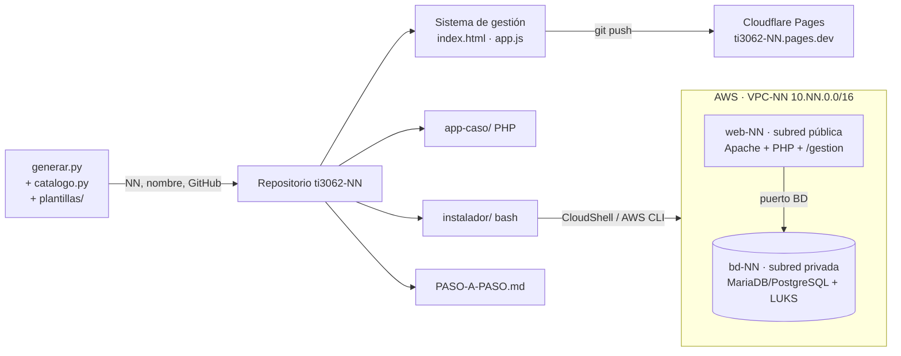

# PlanSec-Cloud

Generador automático de proyectos de **seguridad en infraestructura cloud sobre AWS**: con un comando crea, para cada estudiante, un repositorio listo con el sistema web de gestión del proyecto, la aplicación del caso, los instaladores para AWS y una guía paso a paso personalizada. Cada proyecto sale **distinto** (temática, diseño, motor de base de datos, firewall, zona, controles), de modo que no hay dos páginas iguales.

Pensado para la Evaluación 4 de TI3062 *Gestión de Seguridad de la Información* (INACAP), pero sirve para cualquier práctica de VPC pública/privada con hardening en AWS.

---

## Contenido

- [Cómo funciona](#cómo-funciona)
- [Plataformas compatibles](#plataformas-compatibles)
- [Instalación del generador](#instalación-del-generador)
- [Paso a paso en AWS](#paso-a-paso-en-aws)
- [Variabilidad](#variabilidad)
- [Estructura del repositorio](#estructura-del-repositorio)
- [Seguridad y uso responsable](#seguridad-y-uso-responsable)

---

## Cómo funciona



1. **Generación** (en tu PC): `generar.py` toma el número de lista (NN), el nombre y el usuario de GitHub. Con esos datos calcula una semilla y elige una combinación del `catalogo.py`; luego rellena las plantillas.
2. **Sistema de gestión** (estático, sin backend): reemplaza el informe tradicional. Tiene 8 módulos (resumen con indicadores automáticos, planificación con cronograma, problemática y requerimientos, análisis multicloud, controles NIST SP 800-53, implementación con bitácora y capturas, validación y cierre, documento). Guarda en el navegador, exporta e importa JSON y **genera el PDF desde los datos** con jsPDF.
3. **AWS es el receptor del despliegue**: los scripts de `instalador/aws/` crean la red y las instancias. Los de `instalador/web`, `instalador/bd` y `instalador/comun` dejan cada servidor configurado y endurecido.
4. **Guía**: `PASO-A-PASO.md` trae los comandos exactos con las IP, nombres de usuarios y grupos de ese estudiante.

## Plataformas compatibles

| Dónde | Qué corre | Requisitos |
|---|---|---|
| **Windows 10/11, macOS, Linux** | `generar.py` | Python **3.9+** (sin dependencias externas) |
| **Git / GitHub** | Repositorio `ti3062-NN` con `data/proyecto-NN.json` | Cuenta GitHub, `git` |
| **Cloudflare Pages** | Sistema de gestión (sitio estático) | Cuenta gratuita; también funciona en GitHub Pages, Netlify o cualquier hosting estático |
| **AWS Academy (Learner Lab)** o cuenta AWS | VPC, subredes, IGW, rutas, Security Groups, EC2, NAT temporal, snapshots | Región `us-east-1`; AWS CloudShell o AWS CLI v2 |
| **Ubuntu Server 24.04 LTS** (EC2) | Scripts de instalación y hardening | Probado para 24.04; 22.04 debería funcionar |
| **MariaDB** o **PostgreSQL** | Base de datos del caso | Instalados por el script |
| **Navegadores** | Sistema de gestión y PDF | Chrome, Edge, Firefox, Safari recientes |
| **Cliente SSH** | Acceso a web/bd (ProxyJump) | OpenSSH (incluido en Windows 10+, macOS y Linux) |
| **App TOTP** | MFA del administrador | Google Authenticator, Microsoft Authenticator, Aegis, etc. |

## Instalación del generador

```bash
git clone https://github.com/Bacorsx/PlanSec-Cloud.git
cd PlanSec-Cloud
python generar.py --listar-temas
```

Generar un proyecto:

```bash
python generar.py --nn 07 --nombre "Nombre Apellido" --github usuario
# opciones: --tema dental --motor postgresql --semilla otra --inicio 2026-12-01 --salida carpeta --forzar
```

Generar un curso completo (no repite temáticas hasta agotar las 12):

```bash
python generar.py --lote alumnos.csv      # columnas: nn,nombre,github[,tema][,motor]
```

El resultado queda en `salida/ti3062-NN/`.

## Paso a paso en AWS

> Resumen. Cada proyecto generado trae su propio `PASO-A-PASO.md` con los valores ya reemplazados.

### 1. Publicar el repositorio y el sistema

```bash
cd salida/ti3062-NN
git init -b main && git add . && git commit -m "Estructura inicial"
git remote add origin https://github.com/<usuario>/ti3062-NN.git && git push -u origin main
```
Cloudflare → Workers & Pages → Create → Pages → Connect to Git → proyecto `ti3062-NN`, sin build, salida `/`.

### 2. Crear la infraestructura (CloudShell)

```bash
git clone https://github.com/<usuario>/ti3062-NN.git && cd ti3062-NN/instalador/aws
bash 01-crear-infra.sh <TU_IP_PUBLICA>     # VPC-NN, subredes, IGW, rutas, sg-web/sg-bd, web-NN y bd-NN
bash 02-nat-temporal.sh crear              # salida temporal para instalar paquetes en bd
```
Descarga `llave-ti3062-NN.pem` (Actions → Download file).

| Recurso | Valor |
|---|---|
| VPC | `VPC-NN` 10.NN.0.0/16 |
| Subred pública / privada | 10.NN.1.0/24 (ruta 0.0.0.0/0 → IGW) / 10.NN.2.0/24 (solo local) |
| web-NN / bd-NN | 10.NN.1.10 (IP pública) / 10.NN.2.10 (sin IP pública, + disco de 2 GB para LUKS) |
| sg-web-NN | 80/443 desde 0.0.0.0/0 · 22 desde tu IP /32 |
| sg-bd-NN | puerto BD y 22 **solo desde sg-web-NN** |

### 3. Configurar acceso SSH (tu PC)

```
Host web-NN
    HostName <IP_PUBLICA_WEB>
    User ubuntu
    IdentityFile ~/.ssh/llave-ti3062-NN.pem
Host bd-NN
    HostName 10.NN.2.10
    User ubuntu
    IdentityFile ~/.ssh/llave-ti3062-NN.pem
    ProxyJump web-NN
```
Crea las llaves ED25519 de los 3 usuarios y copia los `.pub` a `instalador/llaves/`.

### 4. Base de datos (bd-NN)

```bash
scp -r ti3062-NN bd-NN:~ && ssh bd-NN
cd ~/ti3062-NN/instalador
sudo bash comun/00-paquetes.sh bd
# CloudShell: bash 02-nat-temporal.sh eliminar   → la subred privada queda sin salida
sudo bash bd/01-configurar-bd.sh            # base ti3062_NN, 2 tablas, usuario app_NN solo desde 10.NN.1.10
```

### 5. Aplicación (web-NN)

```bash
ssh web-NN
git clone https://github.com/<usuario>/ti3062-NN.git && cd ti3062-NN/instalador
sudo bash comun/00-paquetes.sh web
sudo bash web/01-instalar-web.sh            # Apache+PHP+TLS, app en / y sistema en /gestion
```

### 6. Endurecimiento (ambas)

```bash
sudo bash comun/01-hardening.sh web <TU_IP_PUBLICA>
sudo bash comun/01-hardening.sh bd
# como administrador: google-authenticator -t -d -f -r 3 -R 30 -w 3
sudo bash comun/99-cerrar-ubuntu.sh         # bloquea la cuenta inicial (máx. 3 usuarios)
```
Aplica grupos funcionales, sudoers por rol, `sshd` endurecido (sin root, sin contraseña, MaxAuthTries 3, AllowGroups), TOTP para administración, auditd y ufw/nftables coherente con los SG.

### 7. Cifrado, respaldo y disponibilidad (bd-NN)

```bash
sudo bash bd/02-luks-respaldos.sh           # LUKS2 en /respaldos
sudo bash bd/03-respaldo-cron.sh            # respaldo diario cifrado
sudo bash bd/04-probar-restauracion.sh      # restauración probada
# CloudShell: bash 03-snapshots-y-evidencias.sh
```

### 8. Validar y generar el informe

Ejecuta las pruebas P1–P8 (precargadas en el módulo *Validación*), sube capturas y hallazgos, completa CIA, riesgos y mejoras, y pulsa **Generar PDF**. Exporta el JSON a `data/proyecto-NN.json` y haz push.

| Prueba | Resultado esperado |
|---|---|
| P1 App desde Internet | Inserta y lista datos |
| P2 nmap a bd desde fuera | Sin acceso, sin IP pública |
| P3 web → BD con usuario app | Solo funciona desde web-NN |
| P4 Internet desde bd | Falla |
| P5 SSH con contraseña / root | Rechazado |
| P6 Admin sin TOTP | Rechazado |
| P7 Comando no autorizado en sudo | Denegado y registrado en auditd |
| P8 Volumen LUKS cerrado | Datos ilegibles |

> ⚠ En AWS Academy la IP pública de web cambia al reiniciar el laboratorio y el volumen LUKS debe abrirse a mano (`bd/02-luks-respaldos.sh abrir`).

## Variabilidad

| Dimensión | Opciones |
|---|---|
| Temática del caso | 12 (veterinaria, biblioteca, taller, canchas, ferretería, gimnasio, mesa de ayuda, ONG, dental, riego, hostal, laboratorio) |
| Sistema de gestión | 8 nombres · 8 paletas con modo oscuro · 8 tipografías · 3 distribuciones · 4 estilos de tarjeta · 3 gráficos · 3 estilos de PDF |
| App del caso | Paleta, tipografía y 3 distribuciones |
| Infraestructura | MariaDB/PostgreSQL · ufw/nftables · us-east-1a/b/c · 4 esquemas de grupos y usuarios · horario y retención del respaldo |
| Contenido | Proveedor alternativo (Azure, GCP, OCI), características, controles NIST extra, riesgos y mejoras |

`instalador/perfil-variantes.json` resume la combinación de cada estudiante. Usa `--semilla` para obtener otra.

## Estructura del repositorio

```
generar.py            Generador (CLI)
catalogo.py           Temáticas, paletas, controles NIST, riesgos, mejoras, proveedores
plantillas/
  sistema/            index.html, app.js (módulos + PDF), styles.css
  app-caso/           index.php (formulario + listado), estilo.css
  instalador/
    config.env        Variables del estudiante
    aws/              01-crear-infra · 02-nat-temporal · 03-snapshots-y-evidencias
    comun/            00-paquetes · 01-hardening · evidencias · 99-cerrar-ubuntu
    web/              01-instalar-web
    bd/               01-configurar-bd · 02-luks-respaldos · 03-respaldo-cron · 04-probar-restauracion
  README.md           README del repositorio del estudiante
  PASO-A-PASO.md      Guía personalizada
```

## Seguridad y uso responsable

- Nunca subas llaves privadas (`.pem`), secretos TOTP, códigos QR, códigos de emergencia ni `/etc/ti3062/db.ini`; el `.gitignore` generado excluye los más comunes.
- Las credenciales de la app viven fuera del código; el usuario de BD no tiene `ALL` ni acceso desde `'%'`.
- Los datos precargados son un **borrador**: resultados, capturas y hallazgos deben salir de la infraestructura real de cada estudiante.

## Créditos

Basado en las guías de [pulentoski/repositorio-configuraciones](https://github.com/pulentoski/repositorio-configuraciones) (VPC en AWS, NIST, SSH/MFA, auditd, respaldos) y la pauta de la Evaluación 4 de TI3062.
