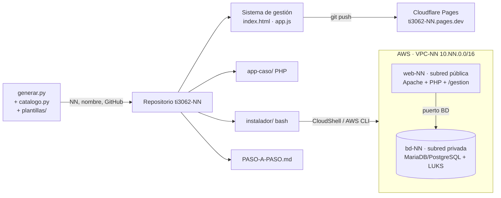

# PlanSec-Cloud

Generador automático de proyectos de **seguridad en infraestructura cloud sobre AWS**: con un comando crea, para cada estudiante, un repositorio listo con el sistema web de gestión del proyecto, la aplicación del caso, los instaladores para AWS y una guía paso a paso personalizada. Cada proyecto sale **distinto** (temática, diseño, motor de base de datos, firewall, zona, controles), de modo que no hay dos páginas iguales.

Pensado para la Evaluación 4 de TI3062 *Gestión de Seguridad de la Información* (INACAP), pero sirve para cualquier práctica de VPC pública/privada con hardening en AWS.

---

## Contenido

- [Cómo funciona](#cómo-funciona)
- [Plataformas compatibles](#plataformas-compatibles)
- [Instalación del generador](#instalación-del-generador)
- [Paso a paso en AWS](#paso-a-paso-en-aws)
- [Variabilidad](#variabilidad)
- [Estructura del repositorio](#estructura-del-repositorio)
- [Seguridad y uso responsable](#seguridad-y-uso-responsable)

---

## Una aplicación, dos capas

Cada proyecto generado es **una sola aplicación en un solo repositorio**, con dos capas separadas, tal como exige la pauta (el sistema de gestión en Cloudflare Pages y la app del caso en web-NN, distinta del sistema):

| Capa | Qué es | Dónde corre |
|---|---|---|
| **Enfoque** (`app-caso/`) | La aplicación del negocio: usuarios por rol, reglas, reportes, auditoría y panel en vivo | web-NN en AWS, con la base en bd-NN |
| **Informe** (raíz + `data/`) | Gestión, planificación, diccionario y generación del PDF | `ti3062-NN.pages.dev` y `/gestion/` en web-NN |

Comparten nombre, colores y navegación, pero no comparten código, sesión ni base de datos. La evidencia medida en la app (TLS, eventos de auditoría, resultados de P1 y P9–P13) pasa al informe con **Exportar evidencia** → **Importar evidencia de la app**. Lo precargado queda marcado como **borrador** hasta que el estudiante lo revisa contra su evidencia real.

## Cómo funciona



1. **Generación** (en tu PC): `generar.py` toma el número de lista (NN), el nombre y el usuario de GitHub. Con esos datos calcula una semilla y elige una combinación del `catalogo.py`; luego rellena las plantillas.
2. **Sistema de gestión** (estático, sin backend): reemplaza el informe tradicional. Tiene 11 módulos (resumen con indicadores automáticos, equipo y roles con responsables, planificación con cronograma, problemática y requerimientos, análisis multicloud, controles NIST SP 800-53, implementación con bitácora y capturas, validación y cierre, contenido del informe editable —portada, introducción, títulos y párrafos de cada sección, pie y referencias—, diccionario, documento). Mientras se rellena **sugiere** contenido desde el diccionario de la plantilla. Guarda en el navegador, exporta e importa JSON y **genera el PDF desde los datos** con jsPDF.
3. **AWS es el receptor del despliegue**: los scripts de `instalador/aws/` crean la red y las instancias. Los de `instalador/web`, `instalador/bd` y `instalador/comun` dejan cada servidor configurado y endurecido.
4. **App del caso** (en web-NN): aplicación PHP con funciones propias de su negocio según el patrón de la temática, usuarios por rol, auditoría inmutable y un panel en vivo que consulta bd-NN por TLS verificado.
5. **Guía**: `PASO-A-PASO.md` trae los comandos exactos con las IP, nombres de usuarios y grupos de ese estudiante.

## Plataformas compatibles

| Dónde | Qué corre | Requisitos |
|---|---|---|
| **Windows 10/11, macOS, Linux** | `generar.py` | Python **3.9+** (sin dependencias externas) |
| **Git / GitHub** | Repositorio `ti3062-NN` con `data/proyecto-NN.json` | Cuenta GitHub, `git` |
| **Cloudflare Pages** | Sistema de gestión (sitio estático) | Cuenta gratuita; también funciona en GitHub Pages, Netlify o cualquier hosting estático |
| **AWS Academy (Learner Lab)** o cuenta AWS | VPC, subredes, IGW, rutas, Security Groups, EC2, NAT temporal, snapshots | Región `us-east-1`; AWS CloudShell o AWS CLI v2 |
| **Ubuntu Server 24.04 LTS** (EC2) | Scripts de instalación y hardening | Probado para 24.04; 22.04 debería funcionar |
| **MariaDB** o **PostgreSQL** | Base de datos del caso | Instalados por el script |
| **Navegadores** | Sistema de gestión y PDF | Chrome, Edge, Firefox, Safari recientes |
| **Cliente SSH** | Acceso a web/bd (ProxyJump) | OpenSSH (incluido en Windows 10+, macOS y Linux) |
| **App TOTP** | MFA del administrador | Google Authenticator, Microsoft Authenticator, Aegis, etc. |

## Instalación del generador

```bash
git clone https://github.com/Bacorsx/PlanSec-Cloud.git
cd PlanSec-Cloud
python generar.py --listar-temas
```

Generar un proyecto:

```bash
python generar.py --nn 07 --nombre "Nombre Apellido" --github usuario
# opciones: --tema dental --motor postgresql --semilla otra --inicio 2026-12-01 --salida carpeta --forzar
```

Generar un curso completo (no repite temáticas hasta agotar las 12):

```bash
python generar.py --lote alumnos.csv      # columnas: nn,nombre,github[,tema][,motor]
```

El resultado queda en `salida/ti3062-NN/`.

## Paso a paso en AWS

> Resumen. Cada proyecto generado trae su propio `PASO-A-PASO.md` con los valores ya reemplazados.

### 1. Publicar el repositorio y el sistema

```bash
cd salida/ti3062-NN
git init -b main && git add . && git commit -m "Estructura inicial"
git remote add origin https://github.com/<usuario>/ti3062-NN.git && git push -u origin main
```
Cloudflare → Workers & Pages → Create → Pages → Connect to Git → proyecto `ti3062-NN`, sin build, salida `/`.

### 2. Crear la infraestructura (CloudShell)

```bash
git clone https://github.com/<usuario>/ti3062-NN.git && cd ti3062-NN/instalador/aws
bash 01-crear-infra.sh <TU_IP_PUBLICA>     # VPC-NN, subredes, IGW, rutas, sg-web/sg-bd, web-NN y bd-NN
bash 02-nat-temporal.sh crear              # salida temporal para instalar paquetes en bd
```
Descarga `llave-ti3062-NN.pem` (Actions → Download file).

| Recurso | Valor |
|---|---|
| VPC | `VPC-NN` 10.NN.0.0/16 |
| Subred pública / privada | 10.NN.1.0/24 (ruta 0.0.0.0/0 → IGW) / 10.NN.2.0/24 (solo local) |
| web-NN / bd-NN | 10.NN.1.10 (IP pública) / 10.NN.2.10 (sin IP pública, + disco de 2 GB para LUKS) |
| sg-web-NN | 80/443 desde 0.0.0.0/0 · 22 desde tu IP /32 |
| sg-bd-NN | puerto BD y 22 **solo desde sg-web-NN** |

### 3. Configurar acceso SSH (tu PC)

```
Host web-NN
    HostName <IP_PUBLICA_WEB>
    User ubuntu
    IdentityFile ~/.ssh/llave-ti3062-NN.pem
Host bd-NN
    HostName 10.NN.2.10
    User ubuntu
    IdentityFile ~/.ssh/llave-ti3062-NN.pem
    ProxyJump web-NN
```
Crea las llaves ED25519 de los 3 usuarios y copia los `.pub` a `instalador/llaves/`.

### 4. Base de datos (bd-NN)

```bash
scp -r ti3062-NN bd-NN:~ && ssh bd-NN
cd ~/ti3062-NN/instalador
sudo bash comun/00-paquetes.sh bd
# CloudShell: bash 02-nat-temporal.sh eliminar   → la subred privada queda sin salida
sudo bash bd/01-configurar-bd.sh            # base ti3062_NN, 2 tablas, usuario app_NN solo desde 10.NN.1.10
```

### 5. Aplicación (web-NN)

```bash
ssh web-NN
git clone https://github.com/<usuario>/ti3062-NN.git && cd ti3062-NN/instalador
sudo bash comun/00-paquetes.sh web
sudo bash web/01-instalar-web.sh            # HTTPS, CA de bd, admin de la app; app en / y sistema en /gestion
```

### 6. Endurecimiento (ambas)

```bash
sudo bash comun/01-hardening.sh web <TU_IP_PUBLICA>
sudo bash comun/01-hardening.sh bd
# como administrador: google-authenticator -t -d -f -r 3 -R 30 -w 3
sudo bash comun/99-cerrar-ubuntu.sh         # bloquea la cuenta inicial (máx. 3 usuarios)
```
Aplica grupos funcionales, sudoers por rol, `sshd` endurecido (sin root, sin contraseña, MaxAuthTries 3, AllowGroups), TOTP para administración, auditd y ufw/nftables coherente con los SG.

### 7. Cifrado, respaldo y disponibilidad (bd-NN)

```bash
sudo bash bd/02-luks-respaldos.sh           # LUKS2 en /respaldos
sudo bash bd/03-respaldo-cron.sh            # respaldo diario cifrado
sudo bash bd/04-probar-restauracion.sh      # restauración probada
# CloudShell: bash 03-snapshots-y-evidencias.sh
```

### 8. Validar y generar el informe

Ejecuta las pruebas P1–P13 (precargadas en el módulo *Validación*), sube capturas y hallazgos, completa CIA, riesgos y mejoras, y pulsa **Generar PDF**. Exporta el JSON a `data/proyecto-NN.json` y haz push.

| Prueba | Resultado esperado |
|---|---|
| P1 App desde Internet | Inserta y lista datos |
| P2 nmap a bd desde fuera | Sin acceso, sin IP pública |
| P3 web → BD con usuario app | Solo funciona desde web-NN |
| P4 Internet desde bd | Falla |
| P5 SSH con contraseña / root | Rechazado |
| P6 Admin sin TOTP | Rechazado |
| P7 Comando no autorizado en sudo | Denegado y registrado en auditd |
| P8 Volumen LUKS cerrado | Datos ilegibles |
| P9 Tráfico web → bd | Cifrado (tcpdump ilegible); sin TLS se rechaza |
| P10 5 claves erróneas en la app | Cuenta bloqueada y registrada |
| P11 Auditor intenta registrar | Denegado y registrado |
| P12 XSS / inyección SQL | Se guarda y muestra como texto |
| P13 Borrar la auditoría de la app | Permiso denegado |

> ⚠ En AWS Academy las instancias se detienen al cerrar el laboratorio: web conserva su IP elástica, pero el volumen LUKS debe abrirse a mano (`bd/02-luks-respaldos.sh abrir`).

## Variabilidad

| Dimensión | Opciones |
|---|---|
| Temática del caso | 15 temáticas sobre 5 patrones de negocio (tabla siguiente) |
| Sistema de gestión | 8 nombres · 8 paletas con modo oscuro · 8 tipografías · 3 distribuciones · 4 estilos de tarjeta · 3 gráficos · 3 estilos de PDF |
| App del caso | Paleta, tipografía y 3 distribuciones |
| Infraestructura | MariaDB/PostgreSQL · ufw/nftables · us-east-1a/b/c · 4 esquemas de grupos y usuarios · horario y retención del respaldo |
| Contenido | Proveedor alternativo (Azure, GCP, OCI), características, controles NIST extra, riesgos y mejoras |

### Diccionario base (sugerencias mientras se rellena)

`diccionario.py` es la fuente única de la información base del informe:
- **46 controles NIST SP 800-53 Rev. 5** con familia, descripción, riesgo, punto de aplicación, capa, requerimiento, evidencia sugerida y prueba asociada;
- bancos de texto por módulo: características, requerimientos, hallazgos típicos, riesgos, mejoras, Gobierno TI, introducción, conclusiones, glosario y referencias;
- el **contenido mínimo del informe** según la pauta y la guía U4.

`generar.py` lo adapta a cada plantilla (NN, IP, motor, usuarios, grupos, temática) y lo publica como `data/diccionario-NN.json`. En el sistema de gestión:
- las celdas clave ofrecen una **lista desplegable**, y al escribir un código conocido (por ejemplo `AC-7`) se completan solo las celdas vacías de la fila;
- bajo cada tabla aparece un panel **💡 Sugerencias** con lo que aún no está incluido y un botón para agregar las obligatorias;
- los campos de texto tienen **💡 Sugerir texto**;
- el módulo **Diccionario** permite buscar controles, agregarlos y revisar el contenido mínimo y el glosario;
- el panel de resumen enlaza cada requisito pendiente con el módulo donde se completa.

Las sugerencias nunca sobrescriben lo que ya escribiste. Si falta el archivo, el sistema funciona igual, sin sugerencias.

### Temáticas de la app del caso

| Patrón | Funciones | Temáticas |
|---|---|---|
| Inventario | Stock por ítem, entradas y salidas en transacción, rechazo de stock negativo, stock crítico, valorización, más vendidos | Ferretería, banco de alimentos (ONG), gestor de bodega, heladería |
| Reservas | Agenda por recurso sin dobles reservas (bloque horario o rango de fechas), disponibilidad, cancelar y completar, ocupación | Clínica veterinaria, canchas municipales, clínica dental, hostal |
| Préstamos | Solo se presta lo disponible, devolución, atrasos, mantención, más prestados | Biblioteca, laboratorio de redes |
| Órdenes | Flujo de estados sin retroceso, prioridad o severidad, tiempos de cierre, montos o RTO/MTTR y disponibilidad | Taller mecánico, mesa de ayuda TI, continuidad operativa de data center, diseño y armado de PC (con vista animada de cómo funciona cada componente) |
| Membresías | Planes con valor y duración, vigencia calculada, renovar/suspender, por vencer, ingreso estimado | Gimnasio |

Todas incluyen login con roles (administrador, operador, auditor), bloqueo tras 5 intentos, sesión de 15 min, CSRF, CSP, auditoría inmutable, exportación CSV y el panel "camino del dato" en vivo. El diseño es una interfaz oscura de operación (modo claro opcional) con estados que siempre combinan color, ícono y texto.

`instalador/perfil-variantes.json` resume la combinación de cada estudiante. Usa `--semilla` para obtener otra.

## Estructura del repositorio

```
generar.py            Generador (CLI)
catalogo.py           Paletas, tipografías, grupos, motores, zonas y proveedores (importa controles, riesgos y mejoras del diccionario)
temas.py              Temáticas, patrones de negocio y requerimientos por patrón
diccionario.py        Controles NIST, textos base, hallazgos, glosario y contenido mínimo del informe
plantillas/
  sistema/            index.html, app.js (módulos + PDF), styles.css
  app-caso/publico/   index.php, api.php (en vivo), app.js, estilo.css  → webroot
  app-caso/privado/   nucleo.php, patrones.php, vista_equipo.php, crear-usuario.php → fuera del webroot
  instalador/
    config.env        Variables del estudiante
    aws/              01-crear-infra · 02-nat-temporal · 03-snapshots-y-evidencias
    comun/            00-paquetes · 01-hardening · evidencias · 99-cerrar-ubuntu
    web/              01-instalar-web
    bd/               01-configurar-bd · 02-luks-respaldos · 03-respaldo-cron · 04-probar-restauracion
  README.md           README del repositorio del estudiante
  PASO-A-PASO.md      Guía personalizada
```

## Seguridad y uso responsable

- Nunca subas llaves privadas (`.pem`), secretos TOTP, códigos QR, códigos de emergencia ni `/etc/ti3062/db.ini`; el `.gitignore` generado excluye los más comunes.
- Las credenciales de la app viven fuera del código; el usuario de BD no tiene `ALL`, `DELETE` ni acceso desde `'%'`, y solo se conecta por TLS verificado.
- Antes de cada push, `.githooks/pre-push` ejecuta `instalador/verificar-secretos.sh`, que bloquea llaves privadas, secretos TOTP, `db.ini`, claves de AWS y contraseñas en el código.
- Antes de instalar, `instalador/revisar-instalador.sh` verifica `MANIFIESTO.sha256` (scripts sin cambios no esperados), la sintaxis, los permisos y resume las reglas de red, firewall, sudoers y base de datos que se aplicarán.
- Tras reiniciar el laboratorio, `bd/05-tras-reinicio.sh` reabre el volumen LUKS, verifica el respaldo y deja un resumen para la bitácora; bd-NN muestra un aviso al iniciar sesión mientras el volumen siga cerrado.
- Los datos precargados son un **borrador**: resultados, capturas y hallazgos deben salir de la infraestructura real de cada estudiante.

## Créditos

Basado en las guías de [pulentoski/repositorio-configuraciones](https://github.com/pulentoski/repositorio-configuraciones) (VPC en AWS, NIST, SSH/MFA, auditd, respaldos) y la pauta de la Evaluación 4 de TI3062.
